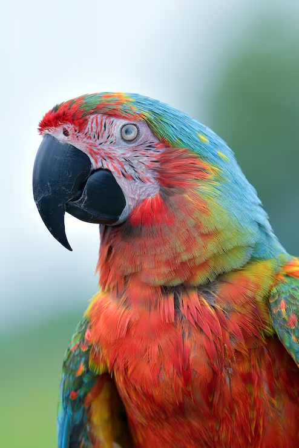
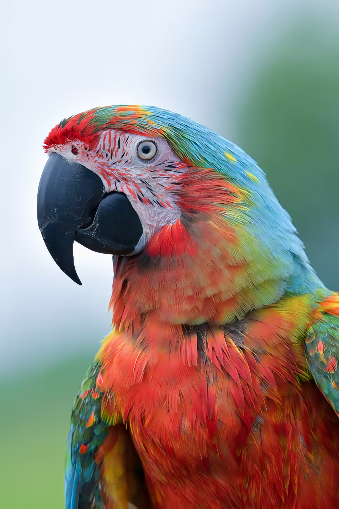
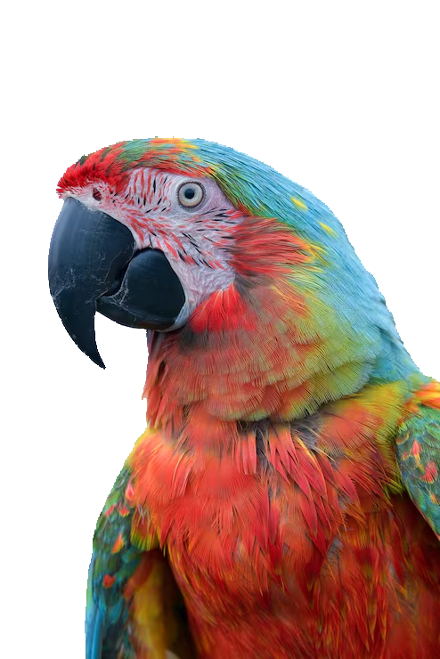

# ONNX tests in Love2D (Lua): inpainting, upscaling, background removal

This project demonstrates the use of ONNX models for inpainting, upscaling, and background removal within the Love2D framework using Lua.

## Features

- **Inpainting**: Modify parts of an image using ONNX inpainting models (fill "holes" in the image).
- **Upscaling**: Enhance image resolution using ONNX upscaling models.
- **Background Removal**: Automatically remove image backgrounds using ONNX models.
- **Colorization**: Automatically add colors to black and white images.
- **Many samples**: I've ran many ONNX model and created samples of their output (and benchmarked their run-time). Also I've collected lists of URLs to download the models.
- **Camera Management**: Manage camera views with mouse wheel and drag.

Note the following:

- **CPU and GPU (DirectML)**: The project currently supports running ONNX models on CPU, and GPU acceleration through DirectML.
- **Threading**: The project uses threading to run ONNX models in background threads, improving performance and responsiveness.
- **FFI**: The project uses LuaJIT's FFI to interface with the ONNX Runtime C API (`onnxruntime.dll`). No additional bindings are required.

## Examples

Inpainting example (took 25 seconds on my PC):

Upscaling example (x4, took 8 sec):

Background removal example (took 15 sec):

There are more than 40 example images located in the `_output` folder.

## Running the Project

1. Download latest `onnxruntime-win-x64-1.**.zip` and extract `onnxruntime.dll` (for CPU only, not CUDA) from [Microsoft repository](https://github.com/microsoft/onnxruntime/releases) and place it in `onnxruntime` directory.
2. Change `WORKING_MODE` at the top of `main.lua` to start background removal, upscaling, or inpainting as needed.
3. Download and place the chosen ONNX models in the `models` folder (rename `model.onnx` to the appropriate file name as listed in the `main.lua`). Corresponding URLs are provided in the `models` folder.

    For a starting point, I recommend those relatively small and fast models:

    - Inpainting: `models/inpaint/inpainting_lama_2025jan.onnx` from [opencv on Hugging Face](https://huggingface.co/opencv/inpainting_lama/tree/main)
    - Upscaling: `models/upscale/4x-ClearRealityV1.onnx` from [kim2091 on Hugging Face](https://huggingface.co/notaneimu/onnx-image-models/tree/main)
    - Background Removal: `models/bg_remove/birefnet-lite-512.onnx` from [studioludens on Hugging Face](https://huggingface.co/studioludens/birefnet-lite-512/tree/main/onnx) and rename to `birefnet-lite-512.onnx`

4. Run the Love2D project as usual.
5. Try other working modes by changing the `WORKING_MODE` in `main.lua` to `"upscaling"`, `"inpainting"`, or `"background_removal"`.
6. Download another models and uncomment the corresponding lines in `main.lua` to use them (`MODEL_UPSCALER_PATH`, `MODEL_INPAINTER_PATH`, `MODEL_BG_REMOVER_PATH`).
7. Put your input images in the `assets` folder and update the corresponding paths in `main.lua`: `IMAGE_PATH` (the main input image) and `IMAGE_WITH_HOLES_PATH` (it's an image with transparent "holes" to be inpainted).

## Requirements

- Tested with Love2D 11.5 under Windows 10 x64

## Input image attribution

The input images used in this project (`assets/parrot.png`, `assets/eiffel_bw.png`) are for demonstration purposes only.

- Parrot image taken from here: [Parrot Image designed by kuritafsheen77 - Magnific.com](https://www.magnific.com/free-photo/closeup-scarlet-macaw-from-side-view-scarlet-macaw-closeup-head_27271706.htm). License type: Free for commercial use WITH ATTRIBUTION license.
- Eiffel Tower image taken from here: [Eiffel Tower Image by Lisa (lisadelarte)](https://unsplash.com/photos/eiffel-tower-at-paris-france-MGDIKg9Bw5U). License type: Free to use under the Unsplash License.

## License

MIT License. See the [LICENSE](LICENSE) file for more details.
